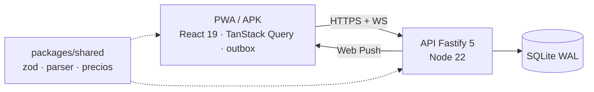

# Compra en Familia

[](LICENSE)


App de gestión de compras para el hogar: listas compartidas en tiempo real, modo tienda con captura de precios, comparador por cadena, historial y notificaciones push. PWA offline-first (cola de mutaciones con idempotencia + WebSocket), también como APK de Android.

## Qué hace

- **Listas compartidas en directo**: lo que añade o tacha cada uno aparece al momento en el resto de móviles.
- **Texto libre**: «2 kg patatas, leche, 6 huevos» se convierte en tres productos con cantidad, unidad y categoría.
- **Sin cobertura**: funciona sin conexión y envía los cambios al volver la red, sin duplicados.
- **Modo tienda**: la lista se ordena por los pasillos de cada súper y se pueden apuntar precios al comprar.
- **Precios**: comparador por cadena, historial y precio por unidad.
- **Avisos push** configurables por persona, sin Firebase.
- **Hogar privado**: alta con código de instalación, invitaciones de un solo uso y roles admin/miembro.

## Arquitectura en una imagen



Más detalle en [docs/arquitectura.md](docs/arquitectura.md) (contenedores, despliegue, modelo de datos, decisiones), [docs/requisitos.md](docs/requisitos.md) y [docs/flujos.md](docs/flujos.md) (alta, offline, tienda, push).

## Stack

- **API** (`apps/api`): Fastify 5, Node 22 (`node:sqlite`, WAL), zod, `web-push`. Sirve también el build estático de la web.
- **Web** (`apps/web`): React 19, Vite 8, TanStack Query (persistido en IndexedDB), react-router 8, Tailwind 4, `vite-plugin-pwa`.
- **Shared** (`packages/shared`): esquemas zod, parsing de texto libre, normalización de precios. Sin build (lo compilan los consumidores).
- **e2e**: Playwright (7 specs: familia, offline, tienda, zz-precios, zz-seguridad, zz-android y zzz-accesibilidad con axe WCAG 2.1 AA). Dependen entre sí y corren en orden alfabético.
- **App de Android**: una TWA (`tools/twa`, Bubblewrap) que abre la web a pantalla completa; ver `docs/OPERACIONES.md`.

## Desarrollo

Requisitos: Node ≥ 22 y pnpm 12.

```bash
pnpm install
pnpm dev:api   # API en :3000 (DATA_DIR=data por defecto)
pnpm dev:web   # Vite en :5173
pnpm typecheck # los 3 paquetes
pnpm test      # unitarios/integración (vitest)
pnpm build     # compila api (tsup) y web (vite)
pnpm e2e       # requiere `pnpm build` antes; usa datos temporales en e2e/.data
```

## Despliegue

Imagen única de Docker (`Dockerfile`, multi-stage, corre como `USER node`):

```bash
docker build --build-arg APP_VERSION=$(git describe --tags 2>/dev/null || echo 0.0.0) -t compra-en-familia:<version> .
```

En el VPS (`~/servicios/compra/`, ver `deploy/docker-compose.yml`): rootless Docker, sin puertos publicados (solo accesible por el túnel de Cloudflare), rootfs de solo lectura, `cap_drop: [ALL]`, límite 512 MiB / 1 CPU, datos en `./data` (SQLite + backups internos cada 6 h, retención 14 días).

## Variables de entorno (API)

| Variable | Defecto | Descripción |
|---|---|---|
| `PORT` | `3000` | Puerto de escucha |
| `DATA_DIR` | `data` | Directorio con `compra.db` y `backups/` |
| `SETUP_CODE` | — | Código que exige el primer registro (crea el hogar). Sin él, la API no se puede inicializar |
| `ALLOWED_ORIGINS` | prod: `https://compra.redgarverde.com` · dev: + `localhost` variantes | Orígenes CORS permitidos |
| `PUBLIC_URL` | `https://compra.redgarverde.com` | URL pública (sujeto VAPID de los push) |
| `APP_VERSION` | `0.0.0` | Versión que reporta `/health` |
| `AUTH_RATE_LIMIT` | interno | Max peticiones/min/IP en rutas de auth |
| `LOG_LEVEL` | `info` | Nivel de log (pino) |
| `WEB_DIR` | `web` | Directorio del build estático de la web |

Web (build): `VITE_API_URL`, `VITE_PUBLIC_URL`.

## Documentación

- `docs/arquitectura.md`, `docs/requisitos.md`, `docs/flujos.md` — diseño, requisitos y flujos con diagramas.
- `docs/GUIA-FAMILIA.md` — cómo se usa (para la familia).
- `docs/OPERACIONES.md` — despliegue, copias y restauración, APK, notificaciones, seguridad y problemas típicos (para quien mantiene el servidor).
- `AGENTS.md` y `.kimi-code/skills/` — convenciones y procedimiento de despliegue.

## Modelo y API

- Un **hogar** (`households`) por despliegue. Registro inicial con `SETUP_CODE`; después solo por invitación de admin (código de un solo uso, 7 días). Roles: `admin` y `member`.
- SQLite con migraciones lineales por `PRAGMA user_version` (ver `apps/api/src/db.ts`). Sin migraciones de bajada.
- Superficie HTTP: todo bajo `/api/...` salvo `GET /health` y el WebSocket `/ws` (autenticación por token en el primer mensaje, 10 s de margen).
- Autenticación: email + contraseña (scrypt), sesiones opacas Bearer (sha256 en reposo, 90 días con deslizamiento).

## Datos y respaldo

- La BD vive en `DATA_DIR/compra.db` (WAL). La API vuelca `VACUUM INTO` a `DATA_DIR/backups/` cada 6 h (una copia por día, 14 días).
- En el VPS, `~/servicios/backup.sh` copia semanalmente (cron) los datos de compra y de Nextcloud a `~/backups/<fecha>/` con retención de 8 copias. Son copias **locales**: protegen contra borrados, no contra fallo de disco. El respaldo off-site está pendiente de decidir destino.

## Notificaciones push

Web Push (VAPID) sin Firebase: claves generadas solas y guardadas en la tabla `kv`. `Notifier` (`apps/api/src/push.ts`) decide a quién avisar (añadidos, asignaciones, «empieza a comprar», lista completa), agrupa avisos seguidos y respeta las preferencias de cada persona. El service worker propio (`apps/web/src/sw.ts`) muestra los avisos, salvo con la app a la vista.

## Seguridad

Cambio de contraseña, lista y cierre de sesiones, y recuperación del acceso por enlace de un solo uso generado por un administrador (sin correo). CSP estricta (helmet), CORS cerrado, rate-limit en auth, consultas preparadas, scopeo por hogar en cada query, verificación de contraseña con comparación de tiempos, allowlist de hosts de push anti-SSRF (`fcm.googleapis.com`, Mozilla, Windows, Apple).

## Licencia

[MIT](LICENSE) © 2026 José Luis García Valverde
