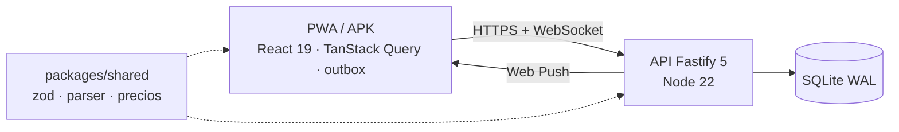

# Compra en Familia

[](LICENSE)


**La lista de la compra de casa, compartida en tiempo real y sin depender de la cobertura.** Una PWA (también como APK de Android) para que toda la familia añada, se reparta y tache productos, y compare precios entre supermercados.

En producción en un servidor casero: ver [homelab](https://github.com/jlgarciavalverde/homelab).

## Qué hace

| | |
|---|---|
| 🛒 **Listas compartidas en directo** | Lo que añade o tacha cada uno aparece al momento en el resto de móviles. |
| ✍️ **Texto libre** | «2 kg patatas, leche, 6 huevos» se convierte en tres productos con cantidad, unidad y categoría. |
| 📶 **Sin cobertura** | Funciona sin conexión y envía los cambios al volver la red, sin duplicados. |
| 🏪 **Modo tienda** | La lista se ordena por los pasillos de cada súper y se pueden apuntar precios al comprar. |
| 💶 **Precios** | Comparador por cadena, con historial y precio por unidad. |
| 🔔 **Avisos push** | Configurables por persona, sin Firebase. |
| 🔐 **Hogar privado** | Alta con código de instalación, invitaciones de un solo uso y roles admin/miembro. |

## Cómo funciona



Cada cambio se aplica al momento en el móvil y se guarda en una cola con una clave de idempotencia. Si no hay red, espera. Cuando vuelve, el servidor lo aplica una sola vez y lo reenvía al resto por WebSocket. Detalle en [arquitectura](docs/arquitectura.md) y [flujos](docs/flujos.md).

| Paquete | Tecnología |
|---|---|
| `apps/api` | Fastify 5, Node 22 (`node:sqlite`, WAL), zod, `web-push`. Sirve también la web. |
| `apps/web` | React 19, Vite 8, TanStack Query persistido en IndexedDB, react-router 8, Tailwind 4, `vite-plugin-pwa` |
| `packages/shared` | Esquemas zod, interpretación de texto libre y normalización de precios |
| `tools/twa` | APK de Android (Trusted Web Activity con Bubblewrap) |
| `e2e` | Playwright: familia, offline, tienda, precios, seguridad, Android y accesibilidad (axe WCAG 2.1 AA) |

## Empezar

Requisitos: Node ≥ 22 y pnpm 12.

```bash
pnpm install
pnpm dev:api     # API en :3000 (datos en ./data)
pnpm dev:web     # web en :5173
```

| Comando | Qué hace |
|---|---|
| `pnpm typecheck` | Tipos de los tres paquetes |
| `pnpm test` | Tests unitarios y de integración (vitest) |
| `pnpm build` | Compila la API (tsup) y la web (vite) |
| `pnpm e2e` | e2e con Playwright (después de `pnpm build`; usa datos temporales en `e2e/.data`) |

## Estructura

```
apps/api/src       servidor: app.ts, db.ts (migraciones), auth, push, realtime, routes/
apps/web/src       PWA: pages/, components/, lib/ (outbox, api, auth, push), sw.ts
packages/shared    contrato y lógica compartida
tools/twa          generador del APK
e2e/               pruebas de extremo a extremo
deploy/            docker-compose de producción
docs/              documentación
```

## Documentación

Índice completo en [docs/](docs/README.md).

| Para… | Lee |
|---|---|
| Entender qué hace y por qué | [Requisitos](docs/requisitos.md) · [Flujos](docs/flujos.md) |
| Entender cómo está hecho | [Arquitectura](docs/arquitectura.md) (componentes, modelo de datos, API, seguridad, decisiones) |
| Usarla en casa | [Guía para la familia](docs/GUIA-FAMILIA.md) |
| Mantener el servidor | [Operaciones](docs/OPERACIONES.md) (variables, despliegue, copias, APK, problemas típicos) |
| Programar en el repo | [AGENTS.md](AGENTS.md) |

## Licencia

[MIT](LICENSE) © 2026 José Luis García Valverde
