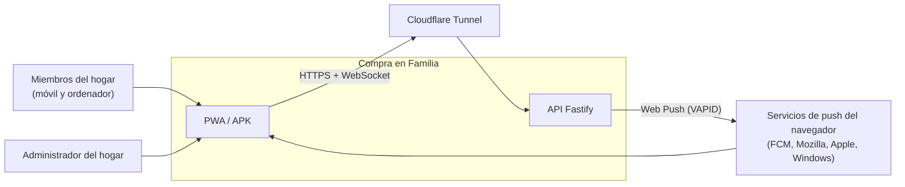
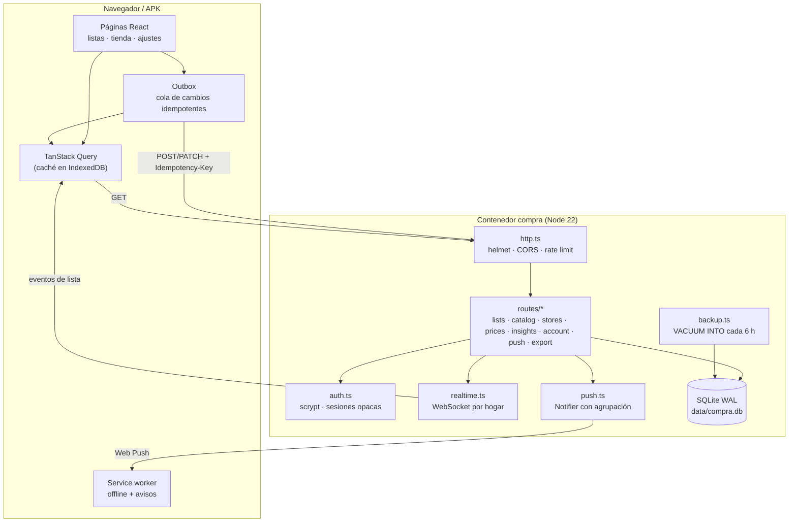
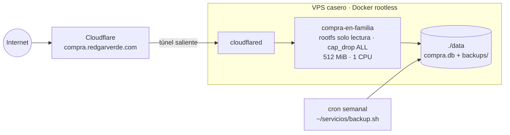
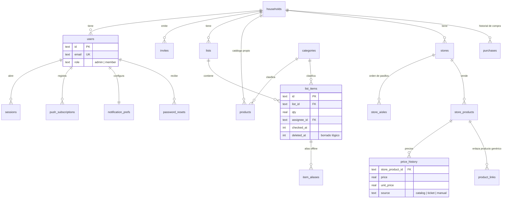

# Arquitectura

[← Documentación](README.md) · [README del proyecto](../README.md)

Compra en Familia es un monorepo pnpm con tres paquetes y una sola imagen de Docker en producción.

| Paquete | Qué es |
|---|---|
| `apps/api` | Fastify 5 sobre Node 22. API REST bajo `/api`, WebSocket `/ws`, Web Push y servidor del build estático de la web. Base de datos `node:sqlite` (WAL). |
| `apps/web` | PWA en React 19 + Vite 8. TanStack Query persistido en IndexedDB, cola de cambios propia (outbox) y service worker propio. |
| `packages/shared` | Esquemas zod compartidos, interpretación de texto libre («2 kg de patatas») y normalización de precios. Sin build: lo compilan sus consumidores. |
| `tools/twa` | Genera el APK de Android (Trusted Web Activity con Bubblewrap) que abre la web a pantalla completa. |

## Contexto

## Contenedores y módulos

## Despliegue

No hay puertos publicados: el único camino de entrada es el túnel de Cloudflare.

## Modelo de datos

Un despliegue sirve a un hogar (`households`). Todas las tablas de negocio llevan `household_id` y cada consulta filtra por él.

Otras tablas: `applied_mutations` (claves de idempotencia ya aplicadas por usuario) y `kv` (claves VAPID y ajustes internos).

Las migraciones son lineales y van por `PRAGMA user_version` en `apps/api/src/db.ts`. No hay migraciones de bajada.

## API

- Todo va bajo `/api/...`, salvo `GET /health` y el WebSocket `/ws`. El WebSocket se autentica con el token en el primer mensaje y da 10 s de margen.
- Autenticación con correo y contraseña (scrypt). Sesiones opacas Bearer, guardadas como sha256 y válidas 90 días con renovación.
- Recursos principales: `lists` e `items`, `catalog` y `suggestions`, `stores` y `prices`, `history`, `household` (invitaciones y miembros), `me` (cuenta y sesiones), `push` y `export`.

## Seguridad

- Cambio de contraseña, lista y cierre de sesiones, y recuperación del acceso con un enlace de un solo uso que genera un administrador (sin correo).
- CSP estricta (helmet), CORS cerrado y límite de peticiones en la autenticación.
- Consultas preparadas, filtradas por hogar, y comparación de contraseñas en tiempo constante.
- Los avisos push solo se envían a hosts permitidos (`fcm.googleapis.com`, Mozilla, Windows, Apple), como protección contra SSRF.

## Decisiones

| Decisión | Por qué |
|---|---|
| SQLite (`node:sqlite`) en lugar de Postgres | Un hogar, pocos usuarios: un archivo con WAL sobra y simplifica copias y restauración. |
| Offline primero con outbox propio | En el súper la cobertura falla. Cada cambio se aplica al momento en local y se envía con una clave de idempotencia, así que reintentar nunca duplica. |
| WebSocket por hogar | Ver en directo lo que añade o tacha el resto mientras se compra. |
| Web Push con VAPID, sin Firebase | Sin cuentas de terceros: las claves se generan solas y se guardan en `kv`. |
| TWA en lugar de app nativa | Una sola base de código. El APK es la misma web a pantalla completa. |
| Imagen única | La API sirve la web: un contenedor, un despliegue y ningún problema de CORS en producción. |
