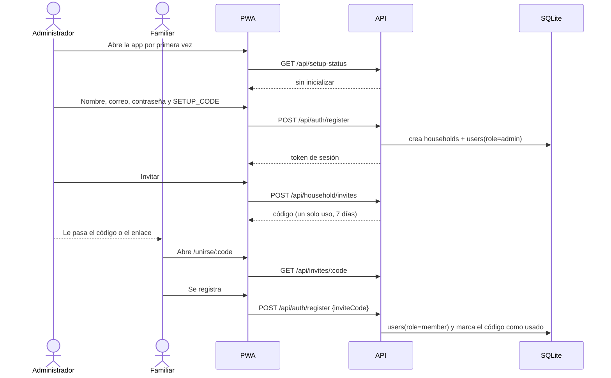
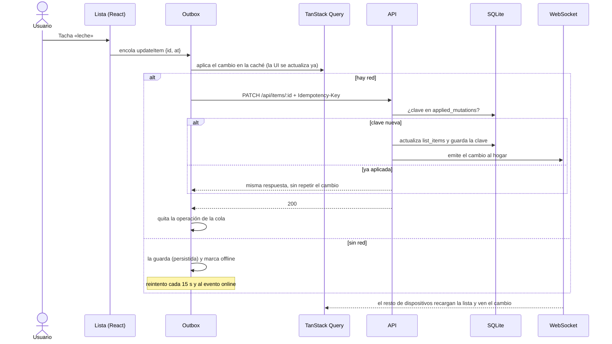
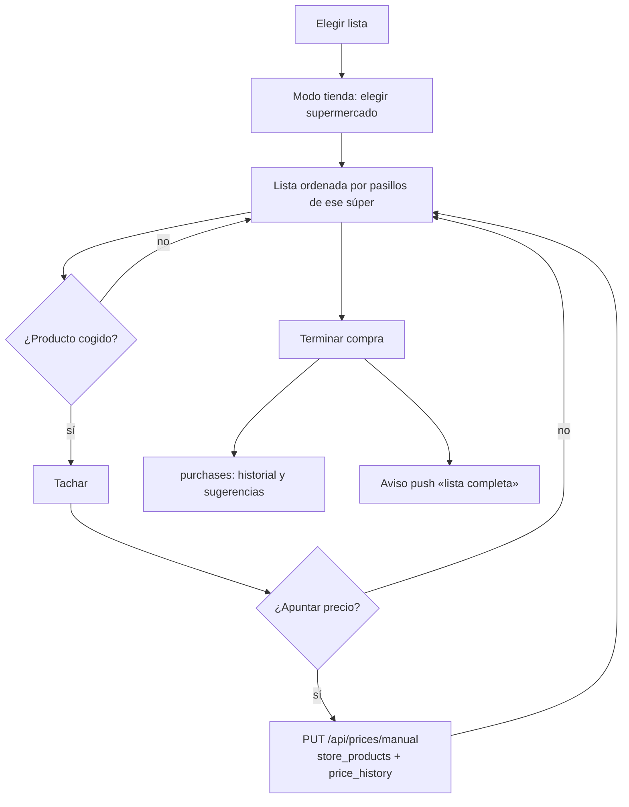
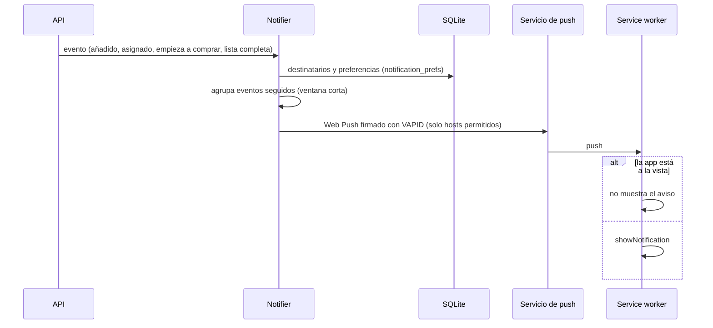

# Flujos principales

## Alta del hogar e invitaciones

## Cambio sin conexión (outbox)

Cada cambio se aplica al momento sobre la caché local y se envía después con una clave de idempotencia. Si la red falla, se queda en la cola y se reintenta cada 15 s o en cuanto vuelve la conexión.

## Compra en tienda y precios

## Avisos push

